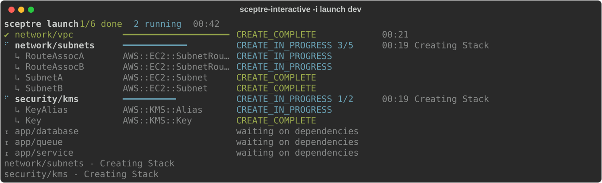
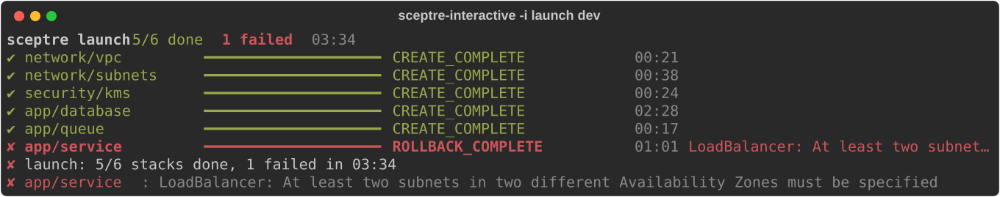
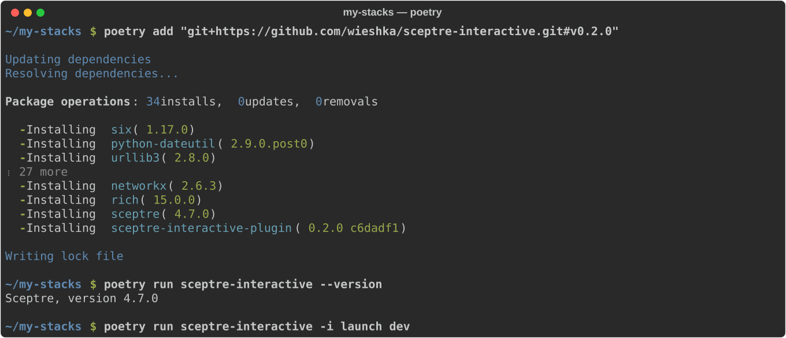
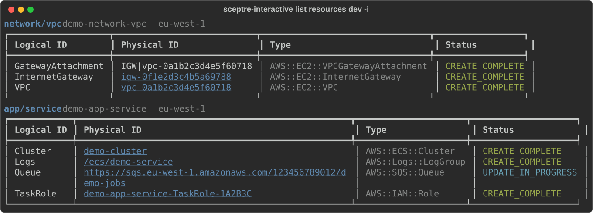

# Sceptre Interactive Plugin

A live progress display for [Sceptre](https://github.com/Sceptre/sceptre),
in the style of `docker pull`, instead of a scrolling log of CloudFormation
events.

While a launch is running:



What stays on screen when it finishes, here with a failed stack:



- One line per stack: spinner, progress bar, CloudFormation status, elapsed time
- The resources currently changing are listed under each running stack
- Stacks waiting on a dependency batch are shown as such
- Failure reasons are shown on the stack's line and in the closing summary
- Sceptre's normal log lines appear in a short footer instead of scrolling past

## Status

Local testing. Sceptre has no plugin hook for CLI options yet, so the plugin
installs a `sceptre-interactive` command: the normal `sceptre` CLI with
`-i/--interactive` added. It works with the released Sceptre (4.7+). It also
exposes `sceptre_interactive:register` under a `sceptre.cli.plugins` entry
point, so plain `sceptre -i` would work once Sceptre loads such plugins.

## Installation

Requires Python 3.10+ and Sceptre 4.7+. Install it into the same environment
as Sceptre, pinned to a release tag.

With Poetry, from your Sceptre project's folder:

```bash
poetry add "git+https://github.com/wieshka/sceptre-interactive.git#v0.2.0"
```



Run it with `poetry run sceptre-interactive ...`. To upgrade, run `poetry add`
again with the new tag.

With pip:

```bash
pip install "sceptre-interactive-plugin @ git+https://github.com/wieshka/sceptre-interactive.git@v0.2.0"
```

## Usage

`-i` works on the root command or on `create`, `update`, `launch` and `delete`:

```bash
sceptre-interactive -i launch dev
sceptre-interactive launch dev --interactive
```

Without `-i`, `sceptre-interactive` behaves exactly like `sceptre`, so you can
alias it:

```bash
alias sceptre=sceptre-interactive
```

Confirmation prompts work as usual; the live display starts after them. When
output isn't a terminal (CI, piping to a file), `-i` falls back to Sceptre's
normal log output. `--no-colour` is respected.

### Resources with console links

`list resources` gets `-i` too. It shows a table per stack, like the
CloudFormation console's Resources tab, with each Physical ID linked to its
page in the AWS console. The stack name links to the stack in the
CloudFormation console.

```bash
sceptre-interactive list resources dev -i
sceptre-interactive list resources dev --urls   # print URLs instead of links
```



- Links are terminal hyperlinks: Cmd/Ctrl-click to open. They work in iTerm2,
  VS Code, WezTerm, kitty, Windows Terminal and most modern terminals. Use
  `--urls` where they don't.
- Resources come from the paginated `ListStackResources` API, so all of a
  stack's resources are listed with type and status. Plain `sceptre list
  resources` shows only IDs, and at most 100 per stack.
- AWS access uses each stack's own profile, region and IAM role from your
  Sceptre config.
- Console URLs come from a hand-maintained list of common resource types in
  `sceptre_interactive/console_links.py`. AWS doesn't publish these console
  URLs, so a link can break if AWS redesigns a console page.
- For types not in the list whose Physical ID is an ARN, the link falls back
  to `https://console.aws.amazon.com/go/view?arn=<arn>`, a generic redirect
  AWS uses but doesn't document. It's best-effort and only used for the
  commercial partition. Other unlisted resources are shown without a link.
- When output is piped, `-i` keeps Sceptre's normal output (`--urls` still
  prints the tables).

## Try it without AWS

```bash
sceptre-interactive-demo            # live display over a simulated 6-stack launch
sceptre-interactive-demo --fail     # app/service fails and rolls back
sceptre-interactive-demo --classic  # the same run with Sceptre's normal log output
sceptre-interactive-demo --speed 3  # faster
```

The demo runs Sceptre's real plan executor and logging. Only the AWS calls are
simulated, and they log events in the same format Sceptre does.

## How it works

With `-i`, the plugin wraps Sceptre's `SceptrePlanExecutor` while the command
runs:

1. When a plan starts executing, it builds the stack list from the plan's
   dependency batches and opens a [Rich](https://github.com/Textualize/rich)
   live display.
2. It notes when each stack starts and finishes, and the result.
3. It temporarily swaps Sceptre's log handler for one that parses the
   CloudFormation event lines Sceptre logs (`<stack> <resource> <type>
   <status> <reason>`) into per-stack and per-resource state.
4. When the plan finishes, it restores the original handler and prints the
   final table and a summary.

Sceptre's code isn't modified, and nothing changes unless `-i` is passed.

## Development

```bash
python3 -m venv .venv && . .venv/bin/activate
pip install -e ".[dev]"
black --check sceptre_interactive tests
pytest --cov=sceptre_interactive
```

The README screenshots are rendered by the plugin's own view code. After
changing how the display looks, regenerate them with:

```bash
python docs/render_screenshots.py
```

On macOS with Python 3.13, if `import sceptre_interactive` fails inside the
venv, run `chflags -R nohidden .venv`. Python 3.13 skips `.pth` files that
have the macOS hidden flag.

## License

Apache 2.0. See [LICENSE](LICENSE).
